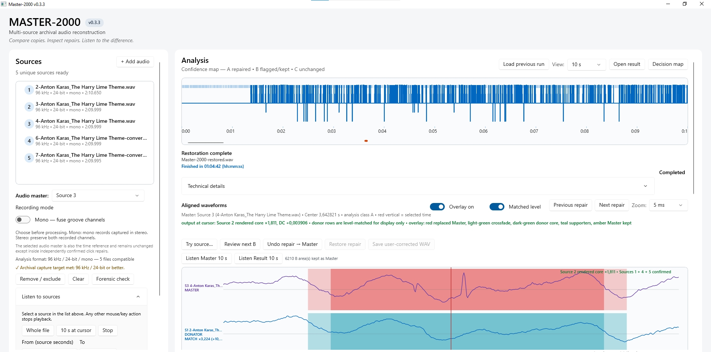
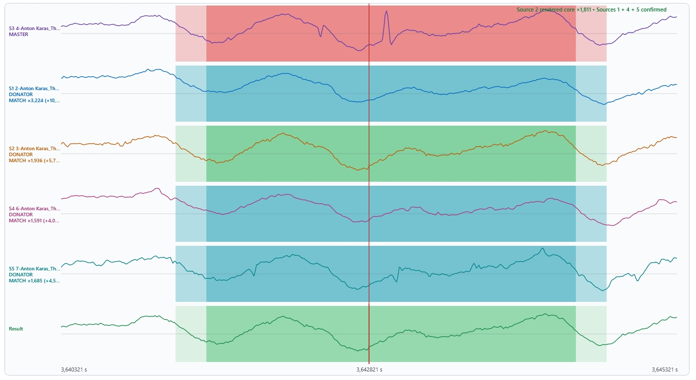

# Master-2000

Master-2000 restores historical recordings by comparing three to six recordings of the same performance from compatible record copies. It replaces locally damaged passages with recorded audio from a donor when another donor supports the repair. When the evidence is insufficient, it retains the selected Master.

The project focuses on mono 78 RPM shellac records. Other media and stereo use require further validation. It does not generate replacement music with AI.

## Download and run

Download the complete ZIP from this repository's Releases page, extract it, and run `Master-2000.exe` or `Mono-78.exe`. Visual Studio is needed only to rebuild the source.

Current package: Master-2000 v0.3.3, build 4 (0.3.3.4), and Mono-78 v1.1a. The developer reports successful standalone operation on a Windows computer without supporting files. This is a reported deployment test, not certification across all Windows installations.

## Screenshots

A completed five-source restoration in Master-2000 v0.3.3. The analysis view provides access to the result, decision map and aligned waveform inspection.

A close-up of one selected repair. The Master is at the top and Result at the bottom. In this example, Source 2 supplies the replacement core and Sources 1, 4 and 5 support the decision. Coloured overlays identify the replaced Master interval, donor core, transitions and supporting sources. Listening and source verification remain necessary when assessing a repair.

## Workflow

1. Preserve each original recording and document its source and recording speed.
2. Add three to six compatible source recordings. Review the proposed Master and source roles.
3. Run restoration, then inspect aligned waveforms and listen to the result.
4. Keep the original sources, result and companion decision/provenance files together for review.

Manual source selection is subject to verification. Optional start blanking previews and saves a separate corrected copy. No automatic end blanking is applied.

To **Load previous run**, select the run's `.decisions.csv`. If prompted for audio, select the original restored Result WAV, rather than the input Master, Master-only output or a separately corrected/start-blanked copy. If source recordings are requested, choose the original inputs.

## Mono-78

Mono-78 is a separate mono and playback-speed conversion tool. Unchanged speed is the default. Target presets are 77.92, 78.26 and 78.00 RPM, plus Custom RPM. Recorded RPM is entered separately. Speed correction changes both duration and pitch; do not apply it twice to an already corrected recording.

## Recording recommendations

For new transfers, use 96 kHz / 24-bit PCM WAV, a stylus suitable for the record, stable documented playback speed and a signal path without clipping or automatic audio enhancement. Preserve the unprocessed originals. Capture both pickup channels where possible. These are project recommendations, not a guarantee that every file can be aligned or repaired.

## Limitations

Shared defects, incompatible pressings, differing performances and ambiguous timing may remain unrepaired. A repair classification is an algorithm decision, not proof of audible correctness. Timing alignment, level matching and splice transitions involve signal processing even though the donor audio comes from recorded sources.

Native regression checks and developer listening tests support this release. Independent testing is welcome. An experimental forensic prototype cannot certify a file as unprocessed.

## Build and documentation

Source projects and build instructions are under `Source/`. Master-2000 retains the internal Vinyl2000 project names. Documentation is under `docs/`; the technical reports are version 0.6 in [English](docs/Master-2000_Technical_Report_v0.6_EN.docx) and [Swedish](docs/Master-2000_Teknisk_rapport_v0.6_SV.docx). Both include the reported standalone deployment test.

## Feedback

Open an Issue with your program version, Windows version, steps to reproduce, expected and actual behaviour, and the affected time range. Short lawful, anonymised samples and diagnostic files are useful. Review logs for personal file paths before sharing. Do not upload copyrighted audio unless you have permission or another applicable right.

## Copyright and licence

The source code is MIT-licensed; retain the included licences and third-party notices. The software licence does not grant rights to recordings or compositions. Check those separately before sharing audio. Owning a physical record does not itself authorise public distribution of its music.

## Antivirus reports

At the developer's pre-release scan, Master-2000 had no detections. The supplied Mono-78 v1.1a binary had detections from Bkav, MaxSecure and DeepInstinct (3 of 71 engines). The detections have not been adjudicated and may be false positives. Source and checksums are supplied for review. Do not disable antivirus protection to run the software.
